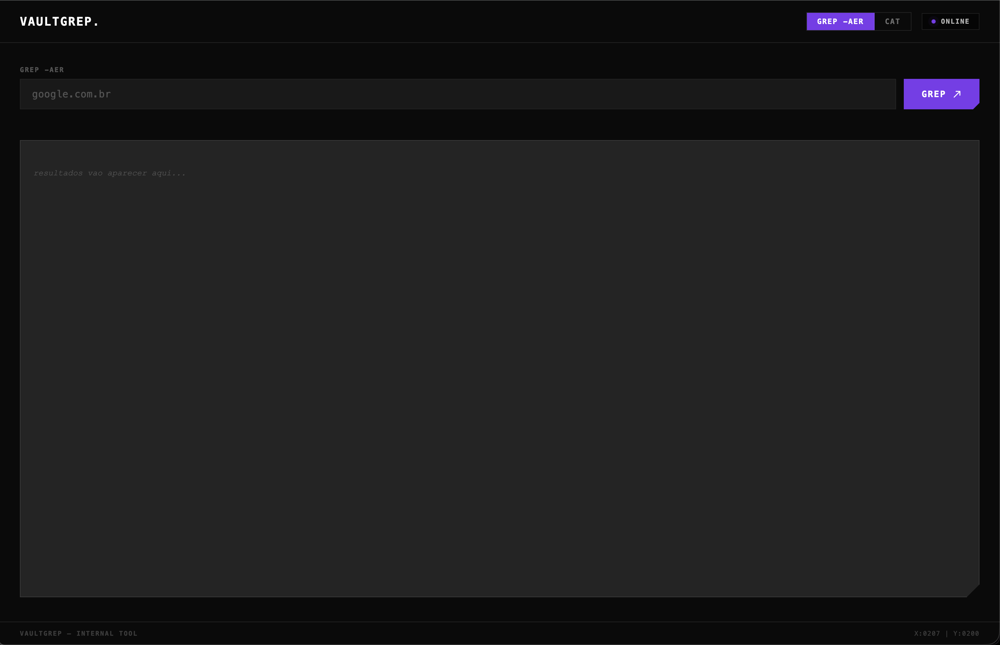

# VAULTGREP

Infraestrutura interna para busca de credenciais vazadas em bases de stealer logs + enriquecimento de CPF e OSINT de e-mail, usada como suporte a engajamentos de pentest e notificação de clientes expostos.



---

## O que faz

| Módulo | O que faz |
|---|---|
| **Busca** (`/search`, `/cat`) | grep/cat sobre `dbs/` (stealer logs `url:user:senha`), streaming + cache SQLite |
| **CPF** (`/cpf`, `/graph`) | consulta querybuscas.com, monta grafo BFS de parentes/empregos, persiste em `vault_graph.db` |
| **E-mail** (`/email`) | OSINT de e-mail: holehe + user-scanner (220+ sites) + emailosint.org, com worker opcional na VPS |
| **Vínculo e-mail↔CPF** (`/vinculos`) | correlação manual — vincula um e-mail a um CPF, aparece na consulta de ambos |
| **Ollama** (`/ollama`) | ingestão/persistência de payloads Ollama |
| **Admin** (`/admin`) | feature toggles por módulo (`grep`, `cat`, `cpf`, `email`) |

---

## Estrutura

```
Vaultgrep/
├── server.py              # Servidor HTTP (ThreadingHTTPServer, Basic Auth)
├── cpf_enrich.py          # Cliente querybuscas + BFS do grafo + SQLite
├── email_osint.py         # OSINT de e-mail (holehe + user-scanner + emailosint.org)
├── email_worker.py        # Worker HTTP para o fan-out de e-mail (VPS, Tailscale-only)
├── ollama_store.py        # Ingestão de payloads Ollama
├── vinculos.py            # Vínculos manuais e-mail↔CPF (SQLite)
├── user_scanner/          # Módulos de enumeração por site (220+)
├── frontend/
│   ├── index.html         # Interface web (cytoscape, hot-reload)
│   └── admin.html         # Painel de feature toggles
├── Dockerfile             # Imagem do servidor principal
├── Dockerfile.email       # Imagem do worker de e-mail
├── docker-compose.yml
├── .env                   # Credenciais (não versionado)
└── data/                  # Estado de runtime (não versionado)
    ├── *.db               # SQLite (search_cache, vault_graph, email_cache, ollama)
    └── features.json      # Feature toggles
```

---

## Formato dos dados

Os arquivos em `dbs/` seguem o formato padrão de stealer logs:

```
<url>:<usuario>:<senha>
```

Exemplos de origem: logs de infostealer, combo lists públicas.

---

## Configuração

Crie um `.env` na raiz do projeto:

```env
# Acesso
USERNAME_VAULT=admin
PASSWORD_VAULT=suasenha
ADMIN_USER=admin
ADMIN_PASS=suasenha

# CPF (querybuscas)
QUERYBUSCAS_USER=...
QUERYBUSCAS_PASS=...

# Captcha Turnstile (CPF)
CAPSOLVER_API_KEY=...

# Rotação de IP do emailosint.org (API Gateway)
AWS_ACCESS=...
AWS_SECRET=...
AWS_REGION=us-east-1

# Worker de e-mail na VPS (opcional — sem ele, o scan roda local)
EMAIL_WORKER_URL=http://<tailscale-ip>:8091
```

- `AWS_*` habilita a rotação de IP via API Gateway no lookup do emailosint.org — sem elas, a consulta roda direto.
- `CAPSOLVER_API_KEY` resolve o Turnstile do querybuscas automaticamente — sem ela, o frontend cai no widget manual.
- `EMAIL_WORKER_URL` delega o fan-out de e-mail (~350 requests) para o worker na VPS, tirando o tráfego do IP residencial.

---

## Executar

### Via Docker (recomendado)

```bash
docker compose up -d --build
```

### Direto (desenvolvimento)

```bash
python3 server.py
```

**Acesso:** `http://localhost:8082`
**Auth:** Basic Auth com as credenciais do `.env`

---

## Endpoints

### GET

| Endpoint | Descrição |
|---|---|
| `GET /` | Interface web |
| `GET /search?q=<termo>&page=<n>` | Busca com streaming em `dbs/` |
| `GET /cat?file=<caminho>` | Leitura de arquivo dentro de `dbs/` |
| `GET /cpf?q=<cpf>&depth=<n>&refresh=<0/1>` | Enriquecimento de CPF (grafo BFS, `depth` até 4) |
| `GET /graph?q=<cpf>` | Reconstrói o grafo do SQLite (0 créditos) |
| `GET /email?q=<email>&provider=all` | OSINT de e-mail (holehe + user-scanner + emailosint.org) |
| `GET /email/leaks?q=<email>` | Senhas vazadas do e-mail no vault |
| `GET /vinculos?cpf=<cpf>` · `?email=<email>` | Lista vínculos e-mail↔CPF |
| `GET /ollama?page=<n>` | Lista payloads Ollama ingeridos |
| `GET /features` | Estado dos feature toggles |
| `GET /admin` | Painel admin (requer `ADMIN_USER`/`ADMIN_PASS`) |
| `GET /health` | Health check |

### POST

| Endpoint | Descrição |
|---|---|
| `POST /cpf/resolver` | `{cpf, token, depth}` — re-consulta após resolver o captcha |
| `POST /vinculos` | `{email, cpf}` — vincula e-mail a CPF |
| `POST /vinculos/remove` | `{email, cpf}` — desfaz o vínculo |
| `POST /ollama/ingest` | Ingestão de payload Ollama |
| `POST /admin/features` | `{feature, enabled}` — liga/desliga um módulo (admin) |

---

## Como funciona a busca

**Chunking por tamanho (load balancing):**
- Arquivos ≥ 200 MB ganham chunk exclusivo com `rg --threads=2`
- Arquivos menores são distribuídos em `N_WORKERS` buckets por bytes totais (greedy), garantindo carga balanceada em vez de apenas igual quantidade de arquivos

**Streaming linha a linha:**
- Cada chunk roda `rg` via `subprocess.Popen` com `--line-buffered`
- Todos os workers rodam em paralelo e alimentam uma fila compartilhada
- O servidor envia via HTTP chunked transfer (`Transfer-Encoding: chunked`) conforme as linhas chegam — resultados aparecem no browser em tempo real
- Ao final, os resultados são cacheados no SQLite para consultas repetidas (resposta instantânea)

**Limites:**
- 5.000 matches por arquivo (`--max-count`)
- 100.000 linhas totais por busca
- Timeout de 120 segundos
- Paginação client-side de 5.000 linhas/página (sem requests extras)

**Cache SQLite:**
- TTL de 10 dias
- Primeira busca: streaming; repetição: servido direto do cache

---

## Endpoint `/cat`

Aceita qualquer formato de path — normaliza automaticamente e faz glob se o arquivo exato não existir (útil para nomes com metadata como `{879.591} [HASH].txt`):

```
/dbs/escape60.com.br          → OK (normaliza prefixo)
/app/dbs/escape60.com.br      → OK
dbs/escape60.com.br           → OK
escape60.com.br               → OK (glob automático)
```

---

## OSINT de e-mail

O `/email` roda três provedores em paralelo, default `provider=all`:

- **holehe** (~130 sites) — enumeração de contas por e-mail
- **user-scanner** (220+ sites, `user_scanner/`) — via `curl_cffi` com impersonation
- **emailosint.org** — validator + data breaches + stealer logs + perfis (SSE stream, Turnstile via Capsolver)

O resultado monta um grafo e-mail → contas/breaches/stealers no frontend, com favicon de cada empresa encontrada.

**Worker na VPS:** com `EMAIL_WORKER_URL` setado, o `/email` local delega o scan para `email_worker.py` (imagem `Dockerfile.email`, porta `8091`), acessível só via Tailscale. O cache de e-mail fica no worker; os vínculos manuais continuam locais.

---

## CPF e grafo

- `cpf_enrich.py` autentica no querybuscas (login → nonce/sig anti-replay) e consulta `cpf/{cpf}`.
- Monta grafo BFS de parentes/empregos até `depth` (máx. 4), com correlação de mãe/pai por nome (busca de homônimos + score de idade/sexo/sobrenome).
- Persiste em `vault_graph.db` (SQLite, WAL). Cache de 21 dias — `refresh=1` re-consulta.
- `/graph` reconstrói do SQLite sem consumir crédito.
- Captcha Turnstile resolvido via Capsolver; fallback para o widget manual no frontend.

---

## Vínculo e-mail↔CPF

Correlação manual: pesquisa o e-mail, vincula a um CPF — ao pesquisar o CPF, o e-mail aparece na ficha (e vice-versa). Add/remove via `POST /vinculos` e `POST /vinculos/remove`. Persistido na tabela `vinculos` do `vault_graph.db`.

---

## Docker

O `docker-compose.yml` monta:

| Volume | Container | Modo |
|---|---|---|
| `./dbs` | `/app/dbs` | read-only |
| `./frontend` | `/app/frontend` | read-only |
| `./data` | `/data` | leitura/escrita |

Duas imagens:

- `Dockerfile` → servidor principal (`grep-cat`, porta `8082`)
- `Dockerfile.email` → worker de e-mail (`email_worker.py`, porta `8091`), sobe separado na VPS

---

## Exemplo de uso

```bash
# Buscar domínio do cliente
curl -u user:senha "http://localhost:8082/search?q=empresa\.com\.br"

# Ler arquivo completo
curl -u user:senha "http://localhost:8082/cat?file=escape60.com.br"

# Enriquecer CPF (grafo nível 3)
curl -u user:senha "http://localhost:8082/cpf?q=000.000.000-00&depth=3"

# OSINT de e-mail
curl -u user:senha "http://localhost:8082/email?q=usuario@dominio.com&provider=all"
```

---

## Segurança

- Acesso restrito por Basic Auth em todos os endpoints
- Endpoint `/cat` bloqueado contra path traversal — restrito a `dbs/`
- Servidor escuta em `127.0.0.1` localmente, `0.0.0.0` no Docker (exposto só na porta mapeada)
- O worker de e-mail fica na VPS acessível **somente via Tailscale**, nunca pelo IP público
- Dados sensíveis — restringir acesso à rede local ou VPN
- Trocar as credenciais do `.env` antes de expor em rede
